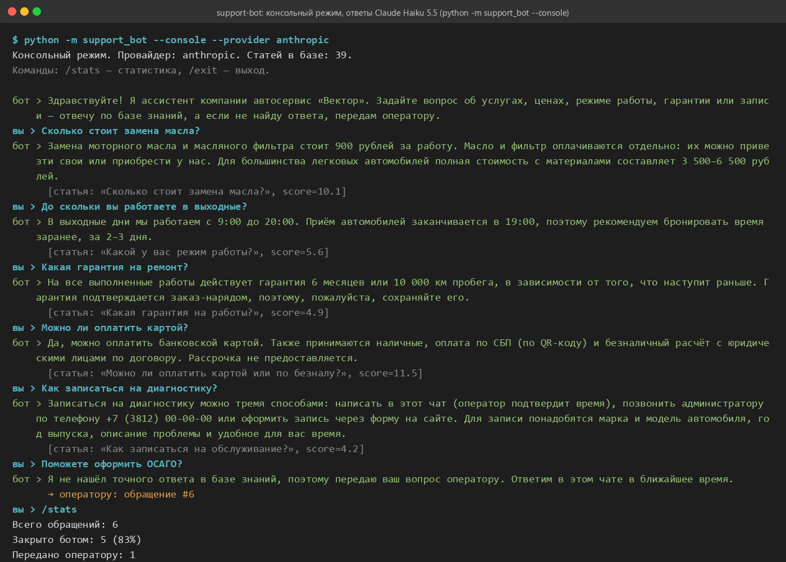

# support-bot — Telegram-ассистент для бизнеса на входящие обращения

Бот отвечает клиентам вымышленного автосервиса «Вектор» (Омск) по базе знаний,
а вопросы, на которые ответа в базе нет, передаёт живому оператору и ведёт журнал
обращений. Рядом лежит тот же сценарий в виде n8n-workflow.

> Pet-проект на синтетических данных: компания, адреса, цены и телефоны вымышлены.
> Собрано с помощью Claude Code на основе open-source шаблонов (см. раздел «На основе»).



На скриншоте — консольный режим с ответами Claude Haiku 5.5: пять вопросов закрыты по базе,
шестой («ОСАГО») передан оператору. Без ключа API те же вопросы отрабатывает заглушка.

## Задача

Малому бизнесу приходят однотипные вопросы в мессенджер: цены, часы работы, адрес,
гарантия, запись. Нужен ассистент, который:

- отвечает на типовые вопросы **только по утверждённой базе знаний**, ничего не выдумывая;
- всё, что не покрыто базой, **передаёт человеку** и доставляет ответ оператора клиенту;
- ведёт **журнал**: кто и что спросил, что ответили, закрыто ботом или передано;
- показывает **метрики**: сколько обращений закрыто автоматически, какие вопросы самые частые.

## Решение

```
клиент → Telegram → поиск по базе (BM25) → Claude (ответ строго по найденному)
                                   ↓ нет статей / модель говорит «не покрыто»
                            чат оператора ← карточка обращения #N
                            клиент ← ответ оператора (reply на карточку или /reply N текст)
                 журнал SQLite → /stats в боте и страница метрик FastAPI (/metrics JSON + HTML)
```

1. **База знаний** — `knowledge/*.md`, 39 статей «вопрос → ответ → теги» (услуги, цены,
   режим работы, гарантия, запись). Правится без кода.
2. **Поиск** — `rank_bm25` поверх простого стеммера русского языка, без внешних сервисов.
   Статьи, в которых нашлось меньше 30 % слов вопроса, модели не отдаются.
3. **LLM** — Claude (`claude-haiku-5-5` по умолчанию) отвечает по найденным статьям
   и возвращает JSON по схеме `{covered, answer}` (structured outputs). `covered=false`
   → обращение уходит оператору. Без ключа API работает детерминированная заглушка:
   отвечает текстом лучшей статьи, если совпадение уверенное.
4. **Передача оператору** — карточка в `OPERATOR_CHAT_ID`; оператор отвечает reply-ем
   или командой `/reply <номер> <текст>`, бот доставляет ответ клиенту и отмечает это в журнале.
5. **Журнал и метрики** — SQLite (`data/dialogs.sqlite3`), команда `/stats`, страница
   `python -m support_bot --metrics` (JSON на `/metrics`, HTML на `/`).
6. **Консольный режим** — тот же ассистент в терминале, для демонстрации и отладки.

## Стек

Python 3.11 · aiogram 3 · anthropic SDK (structured outputs) · rank_bm25 · SQLite ·
FastAPI + uvicorn · pytest · Docker · n8n (экспорт сценария)

## Как запустить

```bash
git clone https://github.com/dobrewoks1/support-bot.git
cd support-bot
python -m venv .venv && .venv\Scripts\activate      # Linux/macOS: source .venv/bin/activate
pip install -r requirements.txt
copy .env.example .env                                # и заполните нужные переменные
```

**Демонстрация без Telegram и без ключа API** (заглушка вместо модели):

```bash
python -m support_bot --console --provider fake
python -m support_bot --ask "Сколько стоит замена масла?" --provider fake
```

**С Claude**: задайте `ANTHROPIC_API_KEY` в `.env` (или в окружении) — провайдер `auto`
выберет Claude сам. Модель меняется переменной `ANTHROPIC_MODEL`.

**Telegram-бот**: создайте бота у @BotFather, впишите `BOT_TOKEN` и `OPERATOR_CHAT_ID`
(личный чат или группа оператора), затем:

```bash
python -m support_bot
```

**Страница метрик** (отдельный процесс, читает тот же SQLite):

```bash
python -m support_bot --metrics        # http://127.0.0.1:8000  и  /metrics
```

**Тесты** (без сети и без ключей — провайдер-заглушка):

```bash
pytest
```

Проверяется: 5 контрольных вопросов отвечаются из базы, 6-й (вне базы) передаётся
оператору, журнал пишется, статистика считается, страница метрик отдаёт JSON и HTML,
консольный режим работает.

**Docker**:

```bash
docker build -t support-bot .
docker run --env-file .env -v %cd%/data:/app/data support-bot
```

## Сценарий в n8n

`n8n/support-bot.workflow.json` — тот же сценарий в виде workflow: **Telegram Trigger →
Code (поиск по встроенной базе, упрощённый BM25) → IF → Basic LLM Chain + Anthropic Chat
Model + Structured Output Parser → IF «ответ найден?» → ответ клиенту / сообщение о
передаче + карточка оператору**.

Импорт: в n8n откройте *Workflows → Create → Import from File*, выберите JSON, затем
в узлах Telegram и Anthropic Chat Model выберите свои credentials и в узле «Настройки»
впишите id чата оператора. Файл генерируется из базы знаний командой
`python n8n/build_workflow.py`, поэтому после правки `knowledge/*.md` его нужно пересобрать.
JSON проверен импортом в n8n 2.43 (CLI `n8n import:workflow`); живой прогон с Telegram
и ключом Anthropic — на стороне владельца инстанса.

## Структура

```
support_bot/
  config.py      настройки из .env            knowledge.py  разбор базы знаний (Markdown)
  search.py      BM25 + стеммер               llm.py        Claude / заглушка, схема ответа
  assistant.py   логика «ответить или передать»   storage.py    журнал SQLite, метрики
  bot/           aiogram: клиентские и операторские обработчики, запуск polling
  console.py     чат в терминале              metrics.py    FastAPI-страница метрик
knowledge/       база знаний (5 файлов, 39 статей)
n8n/             workflow JSON и генератор
tests/           pytest, 28 тестов, без сети
docs/            скриншот
```

## Ограничения и что можно улучшить

- Поиск лексический: синонимы вне тегов статьи не находятся. Следующий шаг — эмбеддинги
  (например, `voyage-3`) с тем же интерфейсом `KnowledgeSearch`.
- Контекст диалога не хранится: каждый вопрос обрабатывается отдельно.
- Заглушка без модели не понимает перефразировок — она нужна для тестов и демонстрации,
  а не как замена LLM.

## На основе

| Что взято | Откуда | Лицензия |
|---|---|---|
| Скелет бота на aiogram 3: `Dispatcher`, роутеры, запуск polling | [aiogram/aiogram — examples/echo_bot.py, examples/multi_file_bot](https://github.com/aiogram/aiogram/tree/dev-3.x/examples) | MIT |
| Подход к поиску: `rank_bm25` + регулярные выражения для токенов, ответ модели только по найденным выдержкам | [levtmn/telegramRAG](https://github.com/levtmn/telegramRAG) | MIT |
| Структура n8n-workflow (Telegram Trigger → AI-узел → Telegram, подключение Chat Model / Output Parser) | шаблоны n8n.io: [«Telegram AI bot assistant» (yulia, #2534)](https://n8n.io/workflows/2534-telegram-ai-bot-assistant-ready-made-template-for-voice-and-text-messages/), [«Manage Telegram task reminders with Claude» (sambhramp, #15933)](https://n8n.io/workflows/15933-manage-telegram-task-reminders-with-claude-and-n8n-data-tables/); демо-workflow [n8n-io/self-hosted-ai-starter-kit](https://github.com/n8n-io/self-hosted-ai-starter-kit) | шаблоны n8n.io публикуются без явной лицензии — заимствована только структура узлов, код узлов написан заново; starter-kit — Apache-2.0 |
| Формат structured outputs (`messages.parse` + Pydantic) | [документация Anthropic](https://platform.claude.com/docs/en/build-with-claude/structured-outputs) | — |

Собственный код проекта — MIT (см. `LICENSE`).

---

**English summary.** Telegram support assistant for a fictional car service: BM25 retrieval
over a Markdown knowledge base, Claude answers strictly from retrieved context and returns a
JSON `{covered, answer}` via structured outputs, uncovered questions are escalated to an
operator chat (operator replies are routed back to the client), every dialog is logged to
SQLite with `/stats` and a FastAPI metrics page. Runs without an API key via a deterministic
fake provider (used by the test suite), ships a console mode, Dockerfile and the same scenario
exported as an n8n workflow. Built with Claude Code on top of MIT/Apache-licensed templates;
all data is synthetic.
